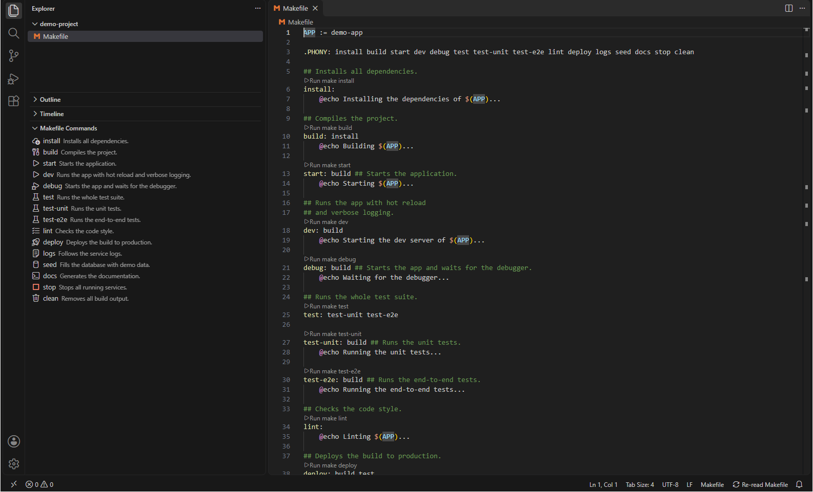
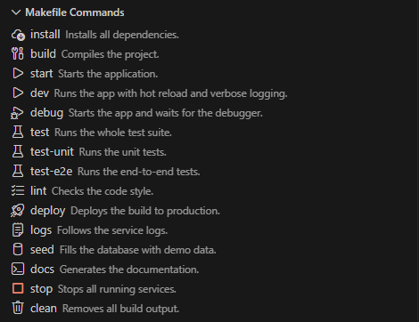
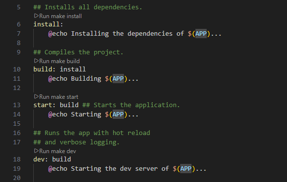

# Makefiles Runner - derDere Fork

>Make runner for VsCode. Simplify your development by easily running your makefiles commands directly from your IDE interface.

This extension is a fork of [Makefiles Runner](https://github.com/Akecel/makefiles-runner) by Akecel. It lists every target the way GNU make reads it, shows `##` descriptions from above and behind a rule, adds icons to the commands and places run buttons above each rule in the editor.

## Usage

- Create your `Makefile` at the root of your project
- Open the **Makefile Commands** view in the Explorer side bar
- Run any command with one click 🚀 – from the view or from the run button above its rule in the editor

## Features

Run your makefile commands from the side bar panel or straight from the Makefile in the editor.

<br />



### Listed commands

The panel lists the targets the way GNU make reads them: every name left of the rule colon is a command, with or without prerequisites (`build: install`). A rule with several targets (`lint format: deps`) lists each of them, and a target defined by several rules appears once.

These lines stay out of the list:

- variable assignments (`APP := demo`, `CFLAGS += -O2`) and target-specific variables (`build: CFLAGS = -O2`)
- special targets such as `.PHONY` and suffix rules such as `.c.o:`
- pattern rules (`%.o: %.c`) and targets built from variables (`$(OUT):`)
- recipe lines, directives (`include`, `ifeq`, `export` …) and the content of `define` blocks

The extension reads the file named `Makefile` in the root of the first workspace folder; rules in files pulled in with `include` stay out of the list. After editing the Makefile, the **Re-read Makefile** button in the status bar refreshes the panel.

### Command descriptions

Comments starting with `##` describe a command. They stand on the lines directly above the rule, behind the rule, or both:

```makefile
## Builds the server and the app.
build: install ## Requires the installed dependencies.
```

Consecutive `##` lines are joined into one description; a blank line or any other line ends the block. Comments with a single `#` are regular comments and stay out of the description. When a rule lists several targets, each of them gets the description. The description appears next to the command in the panel and as its tooltip.

### Icons

Every command shows a [codicon](https://code.visualstudio.com/api/references/icons-in-labels#icon-listing) that matches its name:

| Icon | Command names |
| --- | --- |
| `play` | start, run, up, serve, dev |
| `debug-stop` | stop, down |
| `debug-alt` | debug |
| `cloud-download` | install, restore, deps, pull |
| `tools` | build, compile |
| `beaker` | test |
| `trash` | clean, clear |
| `checklist` | lint, format |
| `rocket` | deploy, release, publish |
| `output` | logs |
| `database` | seed, init |
| `terminal` | every other command |

A name also matches when it starts with the key followed by `-` or `_`, so `test-live` and `test_unit` show the test icon; letter case does not matter. The `icons` setting adds and overrides entries:

```json
"makefilesRunner.icons": {
  "record-fixture": "record",
  "build": "package"
}
```



### Run buttons in the editor

While the Makefile at the root of the workspace is open in the editor, a `▶ Run make <target>` button stands above each rule and runs the command like a click in the panel. The buttons follow the file as you edit it.



## Extension Settings

- `sortAlphabetically`: Sorts the makefile commands shown in the panel in alphabetical order, defaults to false.  When disabled, commands are shown in the same order as they appear within the makefile itself.
- `displayDescriptionCommentsInPanel`: Shows the `##` description of each command as text next to the command in the panel, defaults to true.  The tooltip shows the description regardless of this setting.
- `alwaysCreateNewTerminal`: Creates a new terminal rather than reusing an existing one when set true, defaults to false.
- `reuseMatchingTerminal`: Reuses the first terminal with a matching command label when set true, defaults to false.  Overrides alwaysCreateNewTerminal if both set true, so new terminals will only be created when running a command with no matching terminal.
- `icons`: Assigns codicon ids to commands, e.g. `{ "record-fixture": "record" }`. Keys match a command with the same name or a command starting with the key followed by `-` or `_`; the longest matching key wins. Entries extend and override the built-in mapping, commands without a match show the `terminal` icon.

## Contributing

Please read [CONTRIBUTING.md](https://github.com/derDere/makefiles-runner/tree/main/CONTRIBUTING.md) for details on our code of conduct, and the process for submitting pull requests to us.

## Authors

- [**Akecel**](https://github.com/Akecel) - *Original extension author*
- [**derDere**](https://github.com/derDere) - *Fork maintainer*

## Licence

This project is licensed under the [MIT License](https://opensource.org/licenses)  - see the [LICENSE](https://github.com/derDere/makefiles-runner/blob/main/LICENSE) file for details.

## Show your support

Give a ⭐️ if this project helped you!
